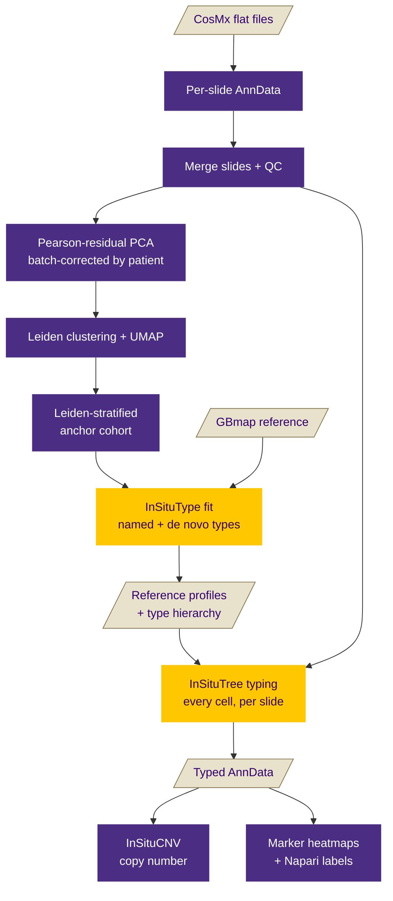
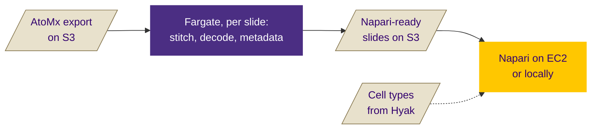

# cosmx-utilities

Cell typing and visualization for [CosMx Spatial Molecular Imager](https://brukerspatialbiology.com/products/cosmx-spatial-molecular-imager/single-cell-imaging-overview/) data, from the [BRaIN Lab](https://dlmp.uw.edu/research-labs/brainlab) at the University of Washington.

The repository has two parts:

- **Cell-typing pipeline** on UW's [Hyak](https://hyak.uw.edu/docs/) cluster: CosMx flat files to typed single-cell AnnData, scaled to cohorts of millions of cells. Jobs are scheduled with [Slurm](https://slurm.schedmd.com/overview.html) and run from [Apptainer](https://apptainer.org/docs/user/main/) containers.
- **Napari visualization** on AWS: whole-slide image stitching on Fargate and an on-demand [Napari](https://napari.org) viewer on EC2, built on a fork of [napari-cosmx](https://nanostring-biostats.github.io/CosMx-Analysis-Scratch-Space/posts/napari-cosmx-intro/).

## Cell-typing pipeline



| Step | Script (`pipeline/slurm/`) | What it does |
|---|---|---|
| Flat files → AnnData | `10_flatfiles_to_anndata.sh` | One `.h5ad` per slide, as a Slurm array |
| QC | `20_concat_qc.sh` | Merge slides, filter cells, select variable genes |
| Batch correction | `30_pearson_pca.sh` | [scPearsonPCA](https://nanostring-biostats.github.io/CosMx-Analysis-Scratch-Space/posts/pearsonpca/) quasi-Poisson residual PCA, corrected by patient; tissue region is kept as biology |
| Clustering | `40_cluster.sh` | Neighbours, Leiden and UMAP on GPU with [rapids-singlecell](https://rapids-singlecell.readthedocs.io/) |
| Anchor cohort | `71_prep_anchor.sh` | Subsample stratified by Leiden cluster, so rare populations reach the fit |
| Tuning | `73_select_genes.sh`, `74_choose_k.sh` | Prune the panel to informative genes; choose the number of de novo clusters |
| Reference fit | `72_anchor_typing.sh` | Semi-supervised [InSituType](https://github.com/Nanostring-Biostats/InSituType) against [GBmap](https://www.gbmap.org/), plus de novo clusters for off-reference tumour states |
| Full-cohort typing | `84` → `85b` → `85c` | [InSituTree](https://github.com/Nanostring-Biostats/CosMx-Analysis-Scratch-Space) hierarchical typing of every cell against the fixed profiles, one job per slide |
| Write-back | `90_write_celltypes.sh` | Labels and posteriors onto the clustered AnnData |
| Copy number | `86`–`88` | [InSituCNV](https://github.com/Moldia/InSituCNV-manuscript) per tissue section, to separate malignant from normal cells ([methods](pipeline/INSITUCNV_METHODS.md)) |

Why the two-stage typing: InSituType's de novo EM does not scale to a full cohort (~7.5M cells), so the reference is fitted once on the anchor cohort. Typing every cell against fixed profiles is then independent per cell, which lets InSituTree run slide by slide in parallel.

Each stage reads and writes on UW Kopah object storage. The same pipeline types our glioblastoma, retina ([notes](pipeline/RETINA_TYPING.md)) and SORL1 ([notes](pipeline/SORL1_40DONOR_TYPING.md)) cohorts with study-specific references. Container recipes are in [`pipeline/containers/`](pipeline/containers/README.md), and reference profiles in [`pipeline/reference/`](pipeline/reference/README.md).

### Running on Hyak

```bash
cp pipeline/.env.example pipeline/.env     # fill in Kopah bucket and prefix
sbatch pipeline/slurm/10_flatfiles_to_anndata.sh
```

Each script's header documents its inputs, outputs and the next job to chain with `--dependency=afterok`. Scripts default to the preemptible `ckpt` partition; run jobs longer than a few hours on a dedicated partition so they are not requeued.

## Napari visualization



```bash
uv sync --extra gui                                                     # install, with the Napari GUI
uv run python scripts/process-slides.py s3://bucket/study/ --whatif     # preview Fargate tasks
uv run python scripts/process-slides.py s3://bucket/study/              # one task per slide
```

The full guide is [`docs/napari.md`](docs/napari.md): carrying annotations into Napari, 3D segmentation, viewing on EC2 or your own machine, and infrastructure setup ([`fargate/FARGATE-SETUP.md`](fargate/FARGATE-SETUP.md)). Container images are published on [GHCR](https://github.com/UW-BRaIN-lab/cosmx-utilities/pkgs/container/cosmx-utilities).

## Repository layout

```
pipeline/            Hyak cell-typing pipeline
  slurm/             one Slurm job per stage, numbered in run order
  python/  R/        the code each job runs
  containers/        Apptainer recipes
  reference/         reference profiles, type hierarchies, gene lists, FOV annotations
scripts/             Napari slide processing, metadata and plotting utilities
napari-cosmx-fork/   fork of napari-cosmx with headless stitching
fargate/  ec2/       AWS task definitions and viewer provisioning
docs/                guides
```

Environment-specific values (bucket names, AWS IDs) live in gitignored `.env` files; copy the matching `.env.example` to start.
